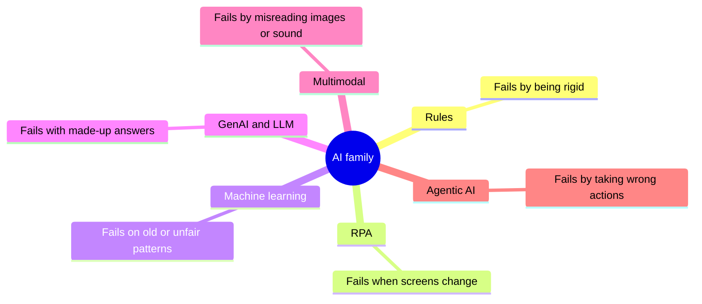

# The AI Family: Six Kinds of AI, Six Kinds of Mistakes

> **In one sentence:** "AI" is not one thing; rules, robots, learning systems, chat AI, picture-reading AI and acting AI each fail in a different way, so each needs a different check.

## The everyday picture

> Imagine six colleagues in a claims office. One follows a checklist word for word. One copies and pastes all day. One learned from thousands of old files. One writes fluent text. One also looks at photos. One holds the keys and acts on their own. Each makes different mistakes, so you supervise each one differently.

When a vendor says "our product uses AI", your first question is: which colleague is this?

## How it works

1. **Rules.** A person writes "if this, then that". The tool follows the rules exactly. Example: pay a travel claim automatically if it is under EUR 100 and the policy is active.
2. **Robotic process automation (RPA).** A software robot repeats the same clicks a person would make. It copies data from an email into a claims screen. It does not think.
3. **Machine learning.** The system learns patterns from thousands of past cases. Nobody writes the rules. Example: a score that flags claims that look like past fraud.
4. **GenAI and large language models.** The system writes new text, one word at a time. Example: a summary of a customer call. Block 2 explains this in detail.
5. **Multimodal AI.** The same idea, but it also reads images, audio or video. Example: a tool that looks at photos of water damage and describes them.
6. **Agentic AI.** The system does not only answer. It acts: it sends, updates, books or pays. Example: a tool that sends a settlement letter. Block 3 explains this in detail.

> **Key warning:** The first two follow fixed steps. The last four give answers that can vary or be wrong. This is the most useful split in the whole family.

## See it

Read it from the centre outwards: each branch is one kind of AI, and the line beneath it is how it tends to fail.

## In an insurance setting

> Fictional - for training only. One home water damage claim, **CLM-2026-04417**, policy **HOM-88231**, estimated damage EUR 3,800.

A new claim passes through a chain of tools. Each tool is a different kind of AI.

```mermaid
flowchart LR
    CL["Home water damage claim<br/>CLM-2026-04417"]:::human -- "claim arrives" --> RU["Rules<br/>Is policy HOM-88231 active?"]:::inside
    RU -- "cover confirmed" --> RP["RPA robot<br/>Copies details into claims system"]:::inside
    RP -- "claim record" --> ML["Risk A: Machine learning<br/>Fraud score from past claims"]:::risk
    ML -- "score" --> MM["Risk B: Multimodal AI<br/>Reads the damage photos"]:::risk
    MM -- "photo findings" --> GE["Risk C: GenAI<br/>Drafts the file summary"]:::risk
    GE -- "summary" --> AG["Risk D: Agentic AI<br/>Sends the settlement letter"]:::risk
    AG -- "letter" --> CU["Customer"]:::outside
    classDef inside fill:#E8F0FE,stroke:#1A56DB,color:#111;
    classDef outside fill:#FDECEA,stroke:#C81E1E,color:#111;
    classDef human fill:#E6F4EA,stroke:#137333,color:#111;
    classDef risk fill:#FFF4E5,stroke:#B45309,color:#111,stroke-dasharray: 5 5;
```

Read it left to right: blue boxes follow fixed steps, and dashed orange boxes can give different or wrong answers.

- **Risk A.** The fraud score was learned from old claims. It may flag customers unfairly, and nobody can say why.
- **Risk B.** The photo tool says "no visible damage" because the photo is dark.
- **Risk C.** The summary states a plumber's invoice of EUR 5,200. No such invoice exists.
- **Risk D.** The agent sends a letter offering a settlement that nobody approved.

The first two boxes can fail too. A rule can miss an unusual case. A robot can copy the wrong field after a screen change. But they fail the same way every time, so you can test them.

**ClaimAssist**, our running case, appears in two places on this map. Version 1 is GenAI: it answers handler questions. Version 3 is agentic: it drafts and sends letters.

## What could go wrong

The eight-step flow in Block 4 describes how GenAI tools work. Here is a first look at where each kind of AI fails.

| Kind of AI | Plain failure | Where it connects to the flow |
| --- | --- | --- |
| Rules | A case the rule writer never imagined | Outside the flow: no model involved |
| RPA | Copies the wrong data after a screen change, and nobody notices | Outside the flow: no model involved |
| Machine learning | Unfair or outdated patterns from training data | Training data, before step 5 |
| GenAI and LLM | Made-up answers; data leaving the company | Steps 4, 5 and 7 |
| Multimodal | Misreads a photo, or obeys text hidden inside an image | Steps 3 and 5 |
| Agentic AI | Wrong action, too much access, no human approval | Step 8 |

## Two views

| Legal & Compliance asks | Risk Management asks |
| --- | --- |
| Which kind of AI is this, as the contract describes it? | Which kind of AI is this, and how does it usually fail? |
| Does the proposal say whether a person makes the final decision? | How bad is a wrong output, and how often could it happen? |
| Were customers told that AI is involved? | What controls catch a wrong output before it reaches a customer? |
| Who is accountable when it gets a case wrong? | What risk is left after those controls? |

## Questions to ask the vendor

1. Which kinds of AI does your product use? Please list each one.
2. Which parts follow fixed rules, and which parts learn or generate?
3. Where does a person review the output before it affects a customer?
4. Does the tool only answer, or can it also act? What can it change?
5. How do you test each part, and how often?
6. What happens when the tool is unsure or fails?

## Proof to ask for

| Proof item | What it shows | Red flag if missing |
| --- | --- | --- |
| Architecture diagram with each AI component named | Which kinds of AI are in the product | Vendor says "it is just AI" and cannot name the parts |
| Test results for each component | Each part was checked on its own | Only one overall accuracy number |
| List of actions the tool can take | What the tool can change in our systems | No list, or "it depends" |
| Description of human review points | Where a person can stop a wrong output | Review is "optional" or "planned" |
| Record of training data sources (for learning components) | Where the patterns come from | Vendor will not say what data was used |

## Key takeaways

- "AI" covers six very different tools. Always ask which kind you are looking at.
- Rules and robots fail the same way every time. Learning, writing, seeing and acting AI can fail differently each time.
- The more the tool can act on its own, the more you need a person in the loop.
