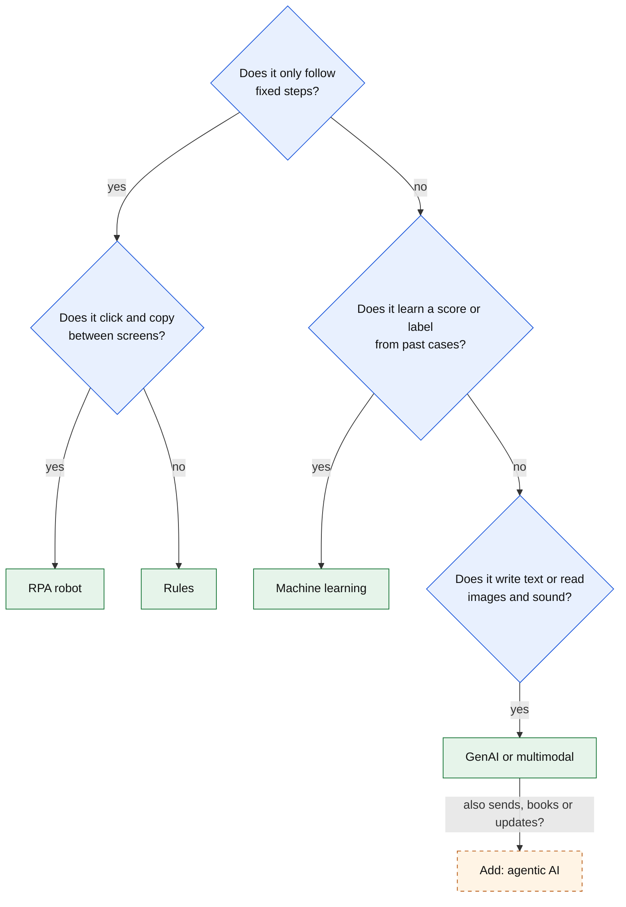

# Hands-on: Which Colleague Is This?

> **In one sentence:** You read five vendor product cards that all say "AI-powered", name the kind of AI inside each, and decide which one needs the closest look.

**Time:** 20 minutes. **Group size:** 4 to 5 people, a mix of Legal & Compliance and Risk Management. No AI tool is needed for this exercise.

## Your task

Five vendors have pitched tools to your organisation. Every card says "advanced AI". You do not know what is really inside.

Your job is to work out which kind of AI each product uses, how it is likely to fail, and what you would ask first. Some products use more than one kind.

> **Key warning:** All products, vendors and numbers here are fictional.

## Material

### Decision guide

Read it from the top: answer each question about a product, and follow the arrows to the kind of AI. A product can land in more than one box.

### The five product cards

> Fictional - for training only.

| Card | Product | What the vendor says |
| --- | --- | --- |
| 1 | TravelPay Auto | "AI-powered. Pays a travel claim automatically when it is under EUR 100, the policy is active and the trip dates match." |
| 2 | KYC Copier | "AI-powered. A software robot opens each customer onboarding form and retypes the details into the identity-check screen." |
| 3 | CyberScore | "AI-powered. Gives every cyber insurance applicant a risk score, learned from thousands of past applications." |
| 4 | CallNotes | "AI-powered. Listens to a customer call recording and writes a summary for the file." |
| 5 | ComplaintPilot | "AI-powered. Reads each complaint, decides its category and urgency, books a callback and emails the team lead." |

## Steps

1. **Sort the cards (8 minutes).** Use the decision guide on each card. Fill in Sheet 1. A few words per cell is enough.
2. **Pick one card (5 minutes).** Choose the card your group would check first. Fill in Sheet 2.
3. Be ready to share your choice in one sentence.

## Your answer sheet

### Sheet 1: What is inside each card

| Card | Kind or kinds of AI | Fixed steps, or can it vary? | How it could fail |
| --- | --- | --- | --- |
| 1. TravelPay Auto | | | |
| 2. KYC Copier | | | |
| 3. CyberScore | | | |
| 4. CallNotes | | | |
| 5. ComplaintPilot | | | |

### Sheet 2: The card you would check first

| Question | Your answer |
| --- | --- |
| Which card, and why? | |
| Legal & Compliance question: is it allowed, is it in the contract, were people told, who is accountable? | |
| Risk question: what could happen, how likely, how bad, what is left after controls? | |
| One proof you would ask to see | |

## Questions to ask the vendor

1. Which kinds of AI does your product use? Please list each one.
2. Which parts follow fixed rules, and which parts learn or generate?
3. Can the product act on its own, or does a person approve first?
4. How do you test each part, and how often?
5. What happens when it fails or is unsure?

## Proof to ask for

| Proof item | What it shows | Red flag if missing |
| --- | --- | --- |
| Architecture diagram naming each component | Which kinds of AI are inside | "It is just AI" |
| Test results for each component | Each part was checked on its own | One overall accuracy number |
| List of actions the product can take | What it can change | No list |
| Description of human review points | Where a person can stop a wrong output | Review is "planned" |

## Key takeaways

- "AI-powered" tells you almost nothing. Ask which kinds, and how each one fails.
- Fixed-step tools fail the same way every time. Tools that learn, write or act can vary.
- The more a product acts alone, the closer you should look.
