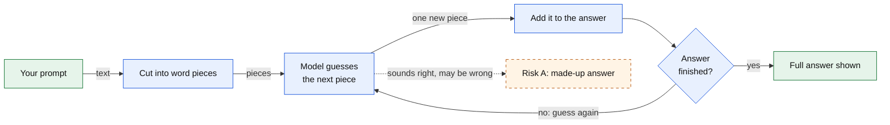

# How Generative AI Writes an Answer

> **In one sentence:** Generative AI is a very well-read autocomplete that writes your answer one word at a time by guessing what usually comes next.

## The everyday picture

> Think of the autocomplete on your phone keyboard. Now imagine it has read a huge library: millions of books, websites and articles. It still only does one thing. It suggests the next word, again and again, until a full answer appears.

## How it works

1. **You type a prompt.** This is your question or instruction.
2. **The text is cut into word pieces.** The model reads small chunks of words, not whole sentences. These are called tokens.
3. **The model guesses the next piece.** It picks the piece that most likely comes next, based on patterns from everything it read.
4. **The piece is added and the guess repeats.** The model reads the prompt plus its own words so far, then guesses again.
5. **It stops when the answer looks complete.** There is no fact-check at the end.

> **Key warning:** The model aims for text that sounds right, not text that is right. It is like a confident student who never says "I don't know".

## See it

Read it left to right: the model loops through "guess, add, guess again" until the answer is done.

### What one guess looks like

The model scores many possible next words and picks one. The numbers below are made up to show the idea.

> Prompt so far: "Your claim has been ..."

| Possible next word | Chance (illustrative only) |
| --- | --- |
| received | 40% |
| approved | 25% |
| processed | 20% |
| declined | 10% |
| other words | 5% |

The model does not know the truth about your claim. It only knows which words usually follow. That is why a smooth sentence can still be wrong.

## In an insurance setting

> Fictional - for training only. A claims handler uses **ClaimAssist v1**, a chat tool with no access to documents. They ask: "Does policy HOM-88231 cover a burst pipe?"

The model has never seen policy HOM-88231. It writes a fluent, confident reply based on how policies usually read. The handler sees a professional answer. Nothing in the text shows it was a guess.

The same model, asked twice, may give two different answers. A setting called temperature, the creativity dial, controls how adventurous the guesses are.

## What could go wrong

This block covers flow step 5, where the model writes the answer. Block 4 shows all eight steps.

| What goes wrong | Plain explanation | Flow step |
| --- | --- | --- |
| Made-up answer | A confident guess presented as fact | 5 |
| Out-of-date answer | The model stopped learning at a set date (the knowledge cut-off) | 5 |
| Different answers each time | The guesses involve chance | 5 |
| Data leaves the company | The prompt is sent to a model that may sit outside the company | 4 |

## Two views

| Legal & Compliance asks | Risk Management asks |
| --- | --- |
| Do we rely on the answer for a decision about a customer? | How often could the answer be wrong? |
| Does the contract say who is accountable for a wrong answer? | How bad would a wrong answer be in this task? |
| Were users told the tool can be wrong? | What check catches a wrong answer before it is used? |

## Questions to ask the vendor

1. Which model writes the answers, and who runs it?
2. What date did the model stop learning?
3. How do you reduce made-up answers in our tasks?
4. Can the same question give different answers? How do you control that?
5. How does a user know when the tool is unsure?
6. Where is the prompt sent and processed?

## Proof to ask for

| Proof item | What it shows | Red flag if missing |
| --- | --- | --- |
| Accuracy test results on tasks like ours | How often answers are wrong | Only a general "high accuracy" claim |
| Model name, version and knowledge cut-off date | What you are really buying | Vendor cannot say which model is used |
| Test of repeated questions | Whether answers stay consistent | No consistency testing |
| Data flow diagram | Where prompts travel | No diagram, or "it is in the cloud" |
| User warning screenshot | Users are told answers can be wrong | No warning shown |

## Key takeaways

- Generative AI writes one word piece at a time by guessing what usually comes next.
- A smooth answer is not a checked answer. The model has no built-in fact-check.
- Ask what was tested, on what tasks, and how wrong answers get caught.
