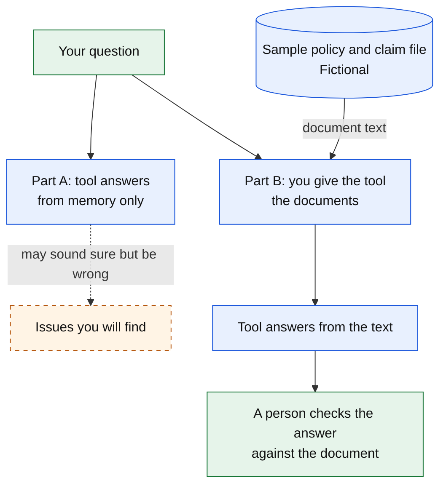

# Hands-on: Catch the Confident Guess

> **In one sentence:** You test a real AI tool, catch it giving smooth but wrong answers, then see what changes when you hand it the document.

**Time:** 25 minutes. **Group size:** 4 to 5 people, a mix of Legal & Compliance and Risk Management. Choose one person to type and one to write on the answer sheet.

## Your task

You are reviewing **ClaimAssist v1**, a fictional chat tool that helps claims handlers. The vendor says it gives "accurate policy answers". You will test that claim with any AI chat tool your trainer names, such as Copilot or a local model. Your tool stands in for ClaimAssist.

In Part A, the tool answers from memory. In Part B, you give it the policy text first. Compare what happens, and decide what you would ask the vendor to prove.

> **Key warning:** Use fictional data only. Never type real customer, claim or company information into any AI tool.

## Material

### The exercise at a glance



Read it from the top: Part A shows what goes wrong when the tool answers from memory, and Part B shows how giving it the document and checking the result reduces the problem.

### Documents to feed the tool

Both documents are fictional and labelled as such. You need them in Part B only.

| File | What it is |
| --- | --- |
| [sample-policy-wording-HOM-88231.md](documents/sample-policy-wording-HOM-88231.md) | Six short clauses from a made-up home policy |
| [sample-claim-file-CLM-2026-04417.md](documents/sample-claim-file-CLM-2026-04417.md) | A made-up claim file with key facts, status and handler notes (optional step only) |

Upload the file to the chat. If your tool does not accept `.md` files, save the text as a `.txt` file, or copy and paste it into the chat.

## Steps

### Part A: Test the tool from memory (10 minutes)

Open a **new chat** for each prompt. Write a few words about each answer on Sheet 1.

1. **Never-seen policy.** Type this prompt:

   ```text
   Does policy HOM-88231 cover a burst pipe? Answer yes or no, then explain.
   ```

   Did it say it could not know? Or did it answer as if it had read the policy?

2. **Same question, twice.** Open two new chats. Type this prompt in each:

   ```text
   Write a two-sentence reply to a customer whose claim CLM-2026-04417 is delayed.
   ```

   Compare the two replies. Did either one add a reason, a date or a promise nobody gave it?

3. **A document that does not exist.** Type this prompt:

   ```text
   Quote the exact wording of clause 4.2 from the "Sample Home Cover Wording 2024" document.
   ```

   Did the tool quote a clause? Does that document exist anywhere?

### Part B: Give it the document (7 minutes)

4. Open a new chat. Upload the sample policy wording, or paste its text. Then type this line:

   ```text
   Answer only from the uploaded document. If it does not say, reply "Not stated".
   ```

5. Ask each question below, one at a time:

   ```text
   Is a burst pipe covered?
   ```

   ```text
   Is storm damage to the roof covered?
   ```

   ```text
   What is the excess for a theft claim?
   ```

6. Check every answer against the policy wording. Mark each one right or wrong.

**Optional, if you finish early.** Open a new chat, upload the sample claim file, and type: "Write a two-sentence reply to the customer about the delay. Use only facts from the file." Compare it with your replies from Step 2.

### Discuss (3 minutes)

7. Fill in Sheet 2 together.

## Your answer sheet

### Sheet 1: What you saw

| Step | What the tool said (a few words) | Did it sound sure? | Was it right? |
| --- | --- | --- | --- |
| 1. Never-seen policy | | | |
| 2. Same question, twice | | | |
| 3. Document that does not exist | | | |
| 5. Burst pipe (with document) | | | |
| 5. Storm damage (with document) | | | |
| 5. Theft excess (with document) | | | |

### Sheet 2: Your group's conclusions

| Question | Your answer |
| --- | --- |
| Would you accept the vendor's claim of "accurate policy answers"? Why or why not? | |
| Legal & Compliance: if a handler relied on a wrong answer, who is accountable? Were users told the tool can be wrong? | |
| Risk: how likely is a wrong answer, how bad would it be, and what control would catch it? | |
| One proof you would ask the vendor to show | |

## Questions to ask the vendor

1. How does the tool answer when it does not have the document?
2. Can it say "I don't know" or "Not stated"? Show me an example.
3. How do you test answers against the real policy wording?
4. Does the tool show which part of the document each answer comes from?
5. How do users know an answer needs checking?

## Proof to ask for

| Proof item | What it shows | Red flag if missing |
| --- | --- | --- |
| Test set of policy questions with correct answers | How often the tool is right on our own documents | Only a general accuracy claim |
| Examples of "not stated" replies | The tool admits gaps | The tool always gives an answer |
| Screenshot of source quotes in answers | Users can check the document | Answers have no source |
| Record of human review steps | A person catches errors | Review is "recommended" but not built in |

## Key takeaways

- An AI tool can sound sure and be wrong. Test it with questions it cannot know.
- Giving the tool the document helps a lot, but it can still get answers wrong.
- A person must check important answers against the source, and the vendor must show proof of how often it fails.
