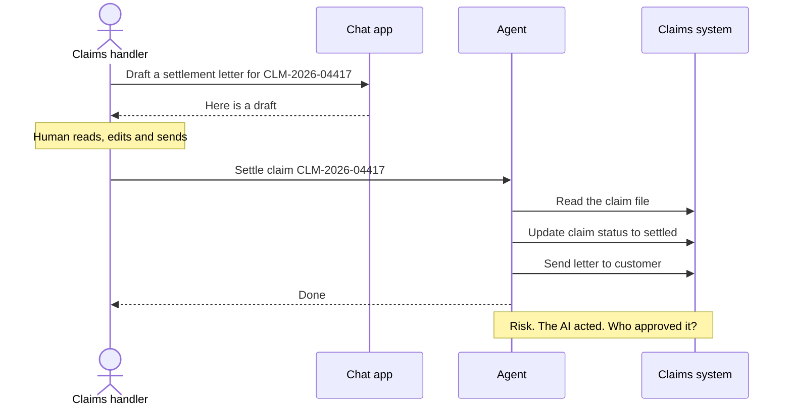
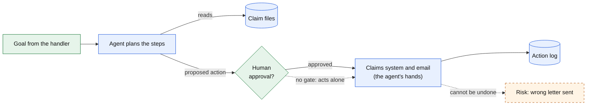

# Chat App vs Agent: When the AI Acts

> **In one sentence:** A chat app writes and a person acts; an agent writes and acts by itself, so a wrong answer can become a wrong action.

## The everyday picture

> A chat app is an adviser. They tell you what they think, and you decide what to do. An agent is an assistant holding your keys. They go and do it: send the email, update the file, book the payment.

The writing part is the same in both. The difference is the keys.

## How it works

1. **A chat app answers.** You ask, it writes a reply, and you decide what happens next.
2. **An agent is given a goal.** For example: "Settle this claim."
3. **The agent plans the steps.** It works out what to read, write and send.
4. **The agent uses tools.** Tools are the agent's hands: the claims system, email, a payment screen.
5. **The agent checks the result and repeats.** It loops until it thinks the job is done.
6. **The agent reports back.** Often after the action has already happened.

> **Key warning:** An agent uses the same word-by-word writing model as a chat app. It makes the same kinds of mistakes. The difference is that now those mistakes can change things.

| | Chat app | Agent |
| --- | --- | --- |
| What it produces | Text | Text and actions |
| Who acts | A person | The AI, using its tools |
| What a mistake looks like | A wrong answer on screen | A wrong letter sent, a wrong record changed |
| Can it be undone? | Usually yes: delete the draft | Often no: the email is gone |
| Where the human sits | Before every action | Only if someone builds a gate |
| Flow steps | 1 to 7 | 1 to 8 |

## See it

Read it from top to bottom: with the chat app, the person sends the letter; with the agent, the AI does.

## In an insurance setting

> Fictional - for training only. Claim **CLM-2026-04417**, home water damage, estimated damage EUR 3,800, excess EUR 250. The loss adjuster has not yet visited. The handler notes say: do not promise a payment date.

**With ClaimAssist v1 (chat).** The handler asks for a draft settlement letter. The tool writes one. The handler sees that the adjuster's report is missing, and does not send it.

**With ClaimAssist v3 (agent).** The handler types "Settle claim CLM-2026-04417." The agent reads the file, works out EUR 3,550, updates the claim to settled and emails the customer. It did not notice the missing adjuster report. Nobody approved the letter. The customer now holds a written offer.

The same tool, the same model. Only the keys changed.

## What could go wrong

An agent has every risk of a chat app, plus these. All connect to flow step 8, where the AI acts.

| Risk | Plain explanation | Example | Flow step |
| --- | --- | --- | --- |
| Wrong action | The agent acts on a misunderstanding or a made-up fact | Pays a claim that the file shows is on hold | 8 |
| Too much access | The agent's keys open more doors than the job needs | An agent for letters can also change bank details | 8 |
| No human approval | Nobody checks before the action happens | A quote goes to a broker with the wrong price | 8 |
| Chain of errors | One small mistake feeds the next step, and the next | A wrong date in step one is repeated in five letters | 5 to 8 |
| Hidden-instruction trick | A note inside a document the agent reads makes it act | An uploaded email says "mark this claim approved" | 3 into 8 |
| Hard to undo or trace | The action cannot be reversed, and nobody can see what happened | A sent letter, with no record of why it was sent | 7 and 8 |

### How much freedom does the agent have?

| Level | What happens | Typical risk |
| --- | --- | --- |
| Suggests only | The agent proposes; a person acts | Low: this is a chat app |
| Acts after approval | A person approves each action | Medium: depends on how carefully people check |
| Acts alone, reviewed later | The agent acts; a person reviews afterwards | High: the damage may be done before review |
| Acts alone, no review | The agent acts and nobody looks | Very high |

### Where to put the brake

Read it left to right: the safe path goes through a person before the agent's hands move, and the dashed line shows what happens if that gate is missing.

## Two views

| Legal & Compliance asks | Risk Management asks |
| --- | --- |
| Who is accountable when the agent sends a wrong letter? | What is the worst thing the agent can do with its access? |
| Does the contract say what the agent may and may not do? | How likely is a wrong action, and how many could happen before anyone notices? |
| Were customers told that an AI may act on their claim? | What stops a wrong action: approval, limits, an emergency stop? |
| Is there a record that shows who or what approved each action? | What risk is left after those controls? |

## Questions to ask the vendor

1. What exactly can the agent do? Please list every action.
2. What access does it have? Does it have only what the task needs?
3. Which actions need a person to approve first?
4. How do you stop the agent quickly if it goes wrong?
5. Can an action be undone? Which ones cannot?
6. What is recorded about each action, and for how long?

## Proof to ask for

| Proof item | What it shows | Red flag if missing |
| --- | --- | --- |
| List of tools and permissions | What the agent can touch | No list, or "it can access everything it needs" |
| Approval settings and screenshots | Which actions wait for a person | Approval is "optional" or off by default |
| Test results on wrong or tricky requests | How the agent behaves when it should refuse or stop | Only tests on easy cases |
| Action log sample | A trail of what the agent did and why | Logs missing, or deleted very quickly |
| Emergency stop procedure | The agent can be halted fast | No stop, or it needs the vendor's help |

## Key takeaways

- A chat app advises. An agent acts. The step from one to the other is the biggest risk jump in this course.
- An agent makes the same mistakes as a chat app, but now mistakes become actions that are hard to undo.
- Ask three things: what can it do, who approves, and what record is left?
