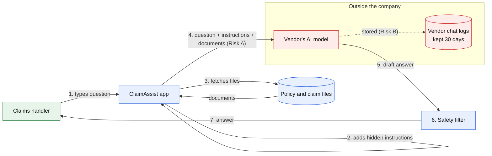
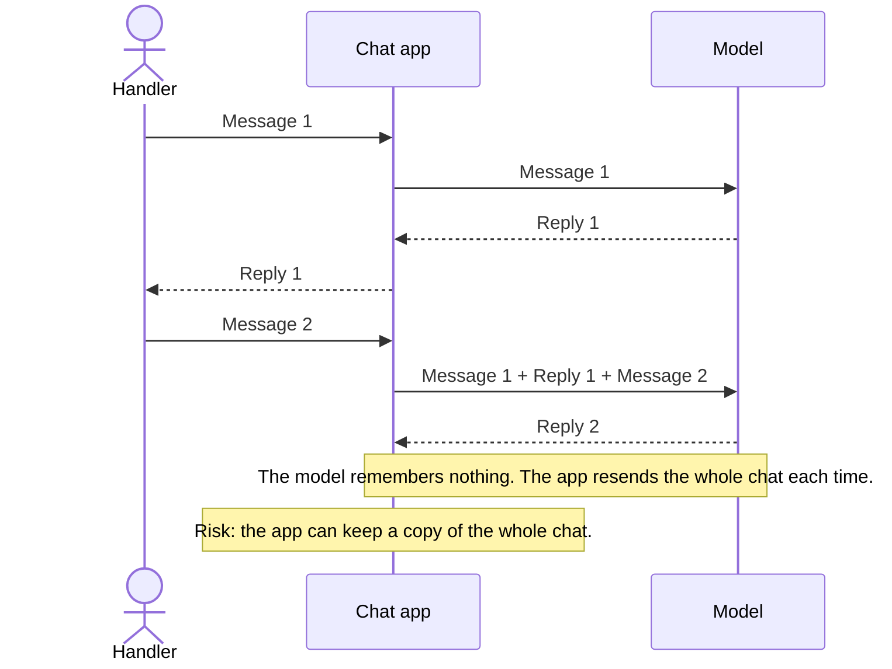

# Where Your Data Goes: The Complete Flow

> **In one sentence:** When you type into an AI tool, your words travel to a model you cannot see, and copies may be stored along the way, so the question is not "will the AI remember me" but "who keeps a copy".

## The everyday picture

> Cooking at home is private: nobody sees your kitchen. Ordering from a restaurant means your order goes to a kitchen you cannot see. The restaurant may keep the order slip, show it to staff, and file it for a month. A cloud AI tool is the restaurant. A model on your own laptop is the home kitchen.

## Three questions everyone asks

People usually ask: "Will the AI remember me? Will it be trained on my words? Can the app read and keep them?" Each question has a different answer.

| Question | Short answer | What is really happening |
| --- | --- | --- |
| Does the model remember what I type? | Not by itself | The model is like a printed book. It does not change when you chat. The app resends your earlier messages each time, so it seems to remember. |
| Will my words be used to train the model? | It depends on the vendor's terms and settings | Training happens when the vendor builds the next version. If the vendor keeps your chats and uses them, your words could shape it. Once mixed in, they are very hard to remove. |
| Can the app read and store my words? | Yes, usually | The app and vendor often keep chat history and logs. How long, where and who can read them varies. This is the main problem. |

> **Key warning:** The model forgetting you is not the same as your data being gone. The copy in the vendor's logs is what matters.

## How it works

The eight steps below are the backbone of the whole course. Every topic links back to them.

1. **The user types a question.**
2. **The app adds hidden instructions.** These are called the system prompt.
3. **The app fetches documents.** This is the open-book exam using our documents, called RAG.
4. **The package is sent to the model.** The package is the question, the hidden instructions and the documents together. It may travel to the cloud or to the company's own servers.
5. **The model writes the answer, word by word.**
6. **Safety filters check the answer.**
7. **The answer is shown, logged, and possibly stored or used for training.**
8. **Only for agents: the AI takes an action.** It sends, updates, books or pays.

> **Key warning:** It is not only your question that travels. The whole package goes, including any document the app attached.

## See it

Read it left to right: anything in the red box has left the company.

- **Risk A.** At step 4, the whole package crosses the boundary, including any personal data in the question or the documents.
- **Risk B.** At step 7, a copy is kept outside the company. Step 8 does not appear because ClaimAssist v2 answers but does not act.

### Why it seems to remember

Read it from top to bottom: the app does the remembering, not the model.

## In an insurance setting

> Fictional - for training only. A handler is rushed. They paste an email from a customer, **Sam Rivera**, about health claim **CLM-2026-05230** into a chat tool, and ask: "Summarise this in three bullets." The email includes Sam's address, date of birth and a description of a medical procedure.

Here is what may happen next:

- The whole email travels to the vendor's model (step 4).
- The summary comes back (step 5), and the handler is happy.
- The vendor keeps the chat for 30 days (step 7). The proposal does not say in which country.
- A vendor staff member, or a vendor's own supplier, could read it during a support check.
- If the vendor's settings allow it, the email could be kept for improving future models.

Health details are among the most sensitive data. The handler thought they were using a helpful tool. They were also sending a copy of a customer's medical details to a company that is not their employer.

### Where a copy can rest

| Place | What is kept | Who might see it | Question to ask |
| --- | --- | --- | --- |
| Your own screen and browser history | Your chat | Anyone with access to your device | Is the device protected? |
| The app's chat history | Every message and reply | Users of the account, administrators | Who can open old chats? |
| Vendor logs and backups | Copies for monitoring and support | Vendor staff and their suppliers | How long? Where? Who? |
| Training data for future models | Chats the vendor chooses to reuse | Mixed into the next model | Is this off in our contract? |
| The model itself today | Nothing from your chat | Nobody | Not the problem |

## What could go wrong

| Risk | Plain explanation | Flow step |
| --- | --- | --- |
| Data leaving | Personal data sent outside the company without a basis | 4 |
| Retention | Copies kept longer than expected or needed | 7 |
| Reuse for training | Your words used to shape a future model | 7 |
| Wider access | Vendor staff or suppliers can read your chat | 7 |
| Leak or breach | The vendor is attacked and logs are stolen | 7 |
| Depending on someone else | You cannot see or control where your data goes | 4 |

The simple local test: if a tool still answers with the internet off, the model is running on that machine, so your question did not have to leave it. This block's live demo shows this with a model on a laptop. A cloud tool stops working the moment the connection goes.

## Two views

| Legal & Compliance asks | Risk Management asks |
| --- | --- |
| Do we have a contract that covers this data going to the vendor? | How likely is it that personal data ends up in a prompt? |
| Were customers told their data could be processed this way? | How bad would a leak of these logs be? |
| Does the contract forbid the vendor from training on our data? | What stops staff pasting sensitive data into the tool? |
| Where is the data stored, and for how long? | What risk is left after the controls? |

Names such as GDPR matter here only as a prompt for the questions. Interpreting them is for your own legal teams.

## Questions to ask the vendor

1. Do you store the questions and answers? For how long, and in which country?
2. Do you use our data to train or improve any model? Is that off by default?
3. Who can read our data, including your staff and your suppliers?
4. Does the tool have a memory feature that keeps details between chats? Can we turn it off?
5. Can we delete our data on request, and can you prove it was deleted?
6. What happens to our data if you are breached, or if you end the contract?

## Proof to ask for

| Proof item | What it shows | Red flag if missing |
| --- | --- | --- |
| Contract clause on training use | Our data is not used to train models | "We may use data to improve our services" |
| Data flow diagram with locations | Where each copy goes | "It is in the cloud" with no detail |
| Retention settings screenshot | How long logs are kept | Retention unknown or "as needed" |
| List of the vendor's suppliers | Who else may handle our data | No list, or "available on request" |
| Deletion test or confirmation | Data really goes when asked | A promise only |
| Independent security report | The vendor was tested by a third party | Only a self-written statement |

## Key takeaways

- The model does not remember you. The app and the vendor may keep a copy, and that is the real risk.
- The whole package travels, not just your question. Check what the app attaches.
- Ask three things: who keeps a copy, for how long, and whether it is used for training.
