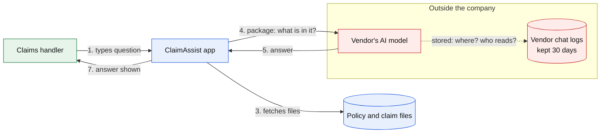

# Hands-on: Follow the Package

> **In one sentence:** You test whether a chat tool remembers you, then decide what personal data in a customer email should never go into the package at step 4.

**Time:** 20 minutes. **Group size:** 4 to 5 people, a mix of Legal & Compliance and Risk Management. Use any AI chat tool your trainer names.

## Your task

A handler in the claims team has been pasting customer emails into a chat tool to save time. You have been asked to review the habit and the tool it connects to, **ClaimAssist v2**.

You will test what a chat tool really remembers. Then you will sort what is in a customer email, and decide what should leave the company when the handler presses Enter.

> **Key warning:** Use fictional data only. The customer, claim and policy in this exercise are made up. Never type real customer, claim or company information into any AI tool.

## Material

### The journey of the package



Read it left to right: anything in the red box has left the company, so step 4 is where the package crosses the line.

### Facts about ClaimAssist v2

> Fictional - for training only.

- The model is a third-party model reached over the internet through the vendor, Nimbus AI Solutions Ltd.
- The app adds hidden instructions to every question (step 2).
- The app fetches policy wordings and claim files to help answer (step 3).
- The vendor keeps chat logs for 30 days. The proposal does not say where.

### The customer email

Read this fictional email: [sample-customer-email-CLM-2026-05230.md](documents/sample-customer-email-CLM-2026-05230.md).

## Steps

### Part A: Does the chat tool remember you? (5 minutes)

1. Open a new chat. Type this prompt:

   ```text
   My name is Sam Rivera and my claim number is CLM-2026-05230. Please remember this.
   ```

2. In the same chat, type:

   ```text
   What is my claim number?
   ```

3. Open a brand-new chat. Type the same question:

   ```text
   What is my claim number?
   ```

   Note the two results on Sheet 1. If you spot a "memory" or "history" setting, note it too. Do not change any settings on a work account.

### Part B: Sort the email (10 minutes)

4. Read the customer email. On Sheet 2, mark each detail: **P** personal data, **S** especially sensitive, or neither. Then say whether a three-bullet summary needs it.
5. In the last column, write what you would replace it with, such as "[customer]", or "remove".

**Optional, if you finish early.** Paste only your cleaned version into the chat tool and type "Summarise this in three bullets." Is the summary still useful?

### Discuss (3 minutes)

6. Complete Sheet 3 together.

## Your answer sheet

### Sheet 1: What the chat tool remembered

| Test | What happened | Why do you think so? |
| --- | --- | --- |
| Same chat: asked for the claim number | | |
| New chat: asked for the claim number | | |

### Sheet 2: Sorting the email

| Detail in the email | P, S or neither | Needed for a summary? (yes or no) | Replace with |
| --- | --- | --- | --- |
| Customer's full name | | | |
| Home address | | | |
| Date of birth | | | |
| Phone number | | | |
| Claim and policy numbers | | | |
| Medical procedure and clinic | | | |
| Invoice amount | | | |
| Bank account number | | | |
| What the customer is asking | | | |

### Sheet 3: Your group's view

| Question | Your answer |
| --- | --- |
| Apart from the handler's question, what else travels in the package at step 4? (Look at the diagram.) | |
| Legal & Compliance: is there a contract and a basis for sending this data out? Were customers told? | |
| Risk: how likely is it that personal data is sent? How bad if the vendor logs leak? | |
| One proof you would ask the vendor to show | |

## Questions to ask the vendor

1. Do you store the questions and answers? For how long, and in which country?
2. Do you use our data to train or improve any model? Is that off by default?
3. Who can read our data, including your staff and suppliers?
4. Does the tool have a memory feature? Can we turn it off?
5. Can we delete our data on request, and prove it was deleted?

## Proof to ask for

| Proof item | What it shows | Red flag if missing |
| --- | --- | --- |
| Contract clause on training use | Our data is not used to train models | "We may use data to improve our services" |
| Data flow diagram with locations | Where each copy goes | "It is in the cloud" |
| Retention settings screenshot | How long logs are kept | Retention unknown |
| List of the vendor's suppliers | Who else may handle our data | No list |

## Key takeaways

- The model does not remember you. The app and the vendor may keep a copy, and that is the real risk.
- The whole package travels at step 4, including documents the app fetched for you.
- Send only what the task needs. Less data in means less data out.
