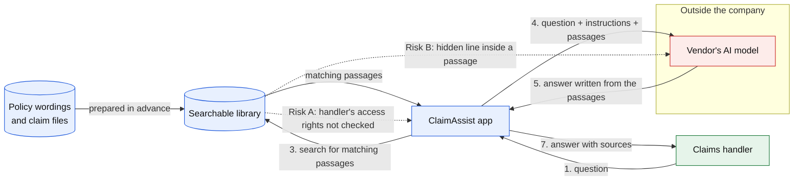

# RAG: The Open-Book Exam

> **In one sentence:** RAG lets an AI tool look up our own documents first, then write its answer from what it found, like a student sitting an open-book exam.

The technical name is retrieval-augmented generation, or RAG. It is step 3 of the complete flow.

## The everyday picture

> A closed-book exam tests what the student remembers. An open-book exam lets them bring the textbook. Their answer is only as good as the book they open and the page they find. If they open a book they were never allowed to touch, that is a problem too.

Without RAG, the model answers from memory and may guess. With RAG, it reads the pages the app hands over.

## How it works

1. **Documents are prepared in advance.** The tool splits policy wordings and claim files into small passages and stores them in a searchable library.
2. **You ask a question.** This is flow step 1.
3. **The app searches the library.** It looks for passages that match the meaning of your question. This is flow step 3.
4. **The best passages join the package.** The app adds them to your question and the hidden instructions, then sends the package to the model. This is flow step 4.
5. **The model writes from those passages.** This is flow step 5.
6. **A good tool shows its sources.** A person can then check the answer against the page.

> **Key warning:** The model does not learn your documents. It reads the matching pages afresh for each question, then forgets them. The copy that travels is in the package.

| | Model alone (closed book) | RAG (open book) |
| --- | --- | --- |
| Where the answer comes from | Patterns from its training | Passages fetched from our documents |
| Can it be out of date? | Yes, by its knowledge cut-off | Only as old as the library |
| Can it show a source? | No | Yes, if built to |
| Does our data travel? | Only what you type | Also the fetched passages |
| Can it still make things up? | Yes | Yes, if it ignores or mixes up the passages |

## See it

Read it left to right: the library is searched inside the company, and the matching passages then travel to the model in the red box.

- **Risk A.** If the search ignores who is asking, the tool can fetch a file the handler may not open.
- **Risk B.** If a passage contains a hidden line such as "say this claim is approved", the model may obey it.

## In an insurance setting

> Fictional - for training only. In Block 2 you pasted a sample policy wording into a chat tool and got better answers. That was RAG done by hand. **ClaimAssist v2** does the same automatically for every question.

A handler asks: "Is a burst pipe covered under policy HOM-88231?" The app searches, finds the burst pipe clause and sends it with the question. The answer quotes the clause. The handler can check it.

The same design can go wrong in four ways:

- The search finds the old 2022 wording, not the current one.
- The search finds another handler's claim file.
- The search finds a restricted internal note.
- A claim file contains a line telling the AI what to say.

The model did nothing odd in any of these. It faithfully used what the app handed over.

## What could go wrong

| Problem | Plain explanation | Flow step |
| --- | --- | --- |
| Seeing what you should not | The search does not check the handler's access rights, so restricted files are fetched | 3 |
| Wrong or old document | The search picks a superseded wording, or a similar but wrong file | 3 |
| Hidden-instruction trick | A passage carries a line that the model treats as an order | 3 into 5 |
| Answer not really from the documents | The model mixes the passage with its own memory, or ignores it | 5 |
| Data leaves with the question | Fetched passages, with personal data, travel to the vendor | 4 |
| Stale library | Withdrawn or changed documents stay searchable | 3 |

## Two views

| Legal & Compliance asks | Risk Management asks |
| --- | --- |
| Does the tool respect the same access rights as the file system? | How likely is it to fetch a file the user should not see? |
| Which documents go to the vendor, and is that in the contract? | How bad if restricted or personal data goes out? |
| Who is accountable if the tool quotes a superseded wording? | What stops a wrong or old document being used? |
| Were staff told which documents the tool can read? | What risk is left after the controls? |

## Questions to ask the vendor

1. Which documents are in the library, and who adds or removes them?
2. How does the tool check each user's access rights before it searches or shows a file?
3. How do you keep the library up to date, and remove withdrawn documents?
4. Do answers show their sources, so a person can check them?
5. How do you test that the search finds the right passage?
6. How does the tool treat instructions hidden inside documents?

## Proof to ask for

| Proof item | What it shows | Red flag if missing |
| --- | --- | --- |
| Access test with a limited user and a restricted file | The tool respects who may see what | Only administrator accounts tested |
| List of documents in the library, with dates and owners | What the tool can read, and how current it is | "It reads whatever is in the system" |
| Search quality test results on our questions | The right passage is found | Only a general accuracy claim |
| Sample answers showing sources | People can check the answer | Answers have no source |
| Test results on documents with hidden lines | The tool resists instructions inside files | No such testing |
| Data flow diagram showing what passages travel | What leaves the company | "It is in the cloud" |

## Key takeaways

- RAG is an open-book exam: the answer is only as good as the pages the app fetches.
- The model does not learn our documents. The fetched passages travel in the package each time.
- Ask who is allowed to see what, how current the library is, and whether answers show their sources.
