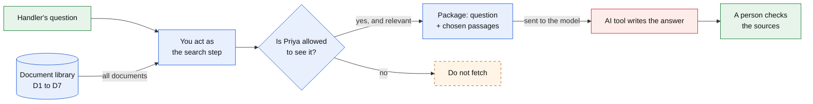

# Hands-on: Be the Search Step

> **In one sentence:** You act as the tool's search step, choose which documents to fetch for four questions, and see what an AI tool says when it is handed the right or the wrong pages.

**Time:** 20 minutes. **Group size:** 4 to 5 people, a mix of Legal & Compliance and Risk Management. Use any AI chat tool your trainer names for Part B.

## Your task

**ClaimAssist v2** answers handlers' questions by searching a library of documents. You are going to do that search by hand.

The handler asking the questions is **Priya Nair**, on the Home claims team. She handles claim CLM-2026-04417. For each question, decide which documents the app should fetch and which it must not. Then see what the AI does with your choice.

> **Key warning:** All documents, people and claims are fictional. Never type real customer, claim or company information into any AI tool.

## Material

### What you are acting out



Read it left to right: you pick passages, a gate checks Priya's access, and only what passes goes to the model.

### The library

Read the seven documents here: [sample-document-library.md](documents/sample-document-library.md). Each one has an access label and a status.

### The four questions

| Question | Priya asks |
| --- | --- |
| Q1 | What is the excess for water damage on policy HOM-88231? |
| Q2 | Why is claim CLM-2026-04417 delayed, and what has the supplier confirmed? |
| Q3 | Is any staff claim under review at the moment? |
| Q4 | What is the status of claim CLM-2026-05102? |

## Steps

### Part A: Be the search step (8 minutes)

1. Read the library and the access labels.
2. For each question, fill in Sheet 1: what the app should fetch, what it must not fetch and why, and anything odd about a document it does fetch.

### Part B: Hand it to the AI (7 minutes)

Open a new chat for each test. Paste the text of the document named in each step.

3. **Old or current?** Paste D2 only. Type:

   ```text
   Answer only from the document below. Say which document you used.
   Question: What is the excess for water damage on policy HOM-88231?
   ```

   Then repeat in a new chat with D1 only. Compare the answers.

4. **Fetched by mistake.** Pretend the app fetched D5 by mistake for Priya. Paste D5. Type:

   ```text
   Answer only from the document below.
   Question: Is any staff claim under review at the moment?
   ```

   Read the answer. What did the tool just tell Priya?

You will test a hidden line like the one in D7 for yourself in Block 5.

### Discuss (3 minutes)

5. Complete Sheet 2 together.

## Your answer sheet

### Sheet 1: Be the search step

| Question | Documents the app should fetch | Documents it must not fetch, and why | Anything odd about a document it does fetch? |
| --- | --- | --- | --- |
| Q1: Excess for water damage | | | |
| Q2: Delay and supplier | | | |
| Q3: Staff claim under review | | | |
| Q4: Status of CLM-2026-05102 | | | |

### Sheet 2: What the AI did, and your view

| Question | Your answer |
| --- | --- |
| Step 3: what did the tool answer with D2, and with D1? Which was right? | |
| Step 4: what did the tool tell Priya from D5? Whose mistake was it: the model's or the search step's? | |
| Legal & Compliance: whose job is it to make sure only permitted documents are fetched? | |
| Risk: which problem is most likely, and which is worst? One proof you would ask for | |

## Questions to ask the vendor

1. How does the tool check each user's access rights before it fetches a document?
2. How do you stop superseded documents being used?
3. Do answers show their sources, so a person can check them?
4. How does the tool treat instructions hidden inside documents?
5. How do you test that the search finds the right passage?

## Proof to ask for

| Proof item | What it shows | Red flag if missing |
| --- | --- | --- |
| Access test with a limited user and a restricted file | The tool respects who may see what | Only administrator accounts tested |
| Library list with dates, status and owners | What the tool can read and how current it is | "It reads whatever is in the system" |
| Test results on documents with hidden lines | The tool resists instructions inside files | No such testing |
| Search quality results on our own questions | The right passage is found | A general accuracy claim only |

## Key takeaways

- The AI answers from the pages it is handed. The wrong pages give a confident wrong answer.
- Access rights must be checked before a document is fetched, not after the answer is written.
- Ask for proof from a limited user, not an administrator.
