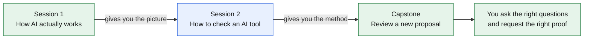

# Welcome to Technical AI Evaluation

> **In one sentence:** This programme teaches you to look at an AI proposal and say how it works, where data goes, what can go wrong, what to ask and what proof to request.

## Welcome

Welcome to **Technical AI Evaluation for Legal, Compliance and Risk Management Teams**. Your trainer is Ramanuj Das, a software engineer and trainer.

You do not need a technical background. You will not build AI. You will review it. Sooner or later, a vendor will bring you an AI proposal and say it is safe, compliant and accurate. This programme helps you check that claim.

## The shift we teach

> A restaurant says "our kitchen is spotless". That is a promise. The hygiene certificate on the wall is proof. This programme teaches you to ask for the certificate.

The core shift is from "I know a rule exists" to "I know how to check that this AI tool actually follows it".

## What you will be able to do

By the end of both sessions, you can look at an AI proposal and say:

1. How it works.
2. Where our data goes.
3. What can go wrong.
4. What to ask the vendor.
5. What proof to request.

## Two views, one explanation

Everyone gets the same explanation. The difference is what you do with a finding.

| Legal & Compliance asks | Risk Management asks |
| --- | --- |
| Is it allowed? | What could happen? |
| Is it in the contract? | How likely is it? |
| Were people told? | How bad would it be? |
| Who is accountable? | What controls exist, and what risk is left? |

Both views appear in every exercise. Work in mixed groups and learn from each other's questions.

## Programme at a glance

Read it left to right: Session 1 builds the picture, Session 2 builds the method, and the capstone puts both to work.

### Session 1: How AI actually works (4 hours)

| Block | Topic | The idea in plain words |
| --- | --- | --- |
| 1 | The AI family | Rules, robots, learning systems and chat AI each fail in different ways |
| 2 | How a language model works | A very well-read autocomplete that guesses the next word |
| 3 | Chat app vs agent | An adviser talks. An assistant holding your keys acts |
| 4 | The complete flow | Eight steps from question to answer, and where your data travels |

### Session 2: How to check an AI tool (4 hours)

| Block | Topic | The idea in plain words |
| --- | --- | --- |
| 5 | What can go wrong | Six risks, each linked to a step in the flow |
| 6 | Rules into questions; promise vs proof | Every rule becomes "how do you do that, and show me" |
| 7 | Guardrails | Layers of safety, like airport security |
| 8 | Capstone | Review a new proposal from start to finish |

## The case we follow

We follow one fictional tool through both sessions. It is called **ClaimAssist**, an AI assistant for claims handlers.

| Version | What it does |
| --- | --- |
| v1 Chat | Answers handler questions |
| v2 Chat + documents | Reads policy wordings and claim files to answer |
| v3 Agent | Drafts and sends settlement letters, and updates the claims system |

Each version brings new risks. You will spot them as the tool grows.

## How we work together

- Ask questions at any time. No question is too basic.
- All people, companies, policies and claims in this programme are fictional.
- Never type real customer, claim or company data into any AI tool during the sessions.
- We frame questions and proof requests. We do not give legal advice.

## Key takeaways

- You review AI; you do not build it. Plain language is the rule.
- A promise is not proof. Always ask what evidence backs a claim.
- Legal & Compliance and Risk Management ask different questions about the same facts. You need both.
