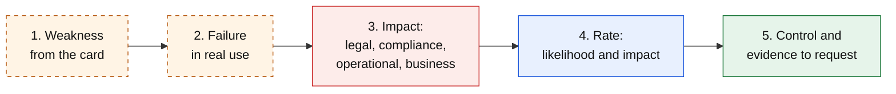

# Hands-on: Follow the Chain

> **In one sentence:** You take two technical findings, follow each to its legal, compliance, operational and business impact, and decide which control and evidence you would ask for.

**Time:** 15 minutes. **Group size:** 4 to 5 people, a mix of Legal & Compliance and Risk Management. No AI tool is needed for this exercise.

## Your task

A vendor review has produced six findings about six different products. Each finding is a technical fact. On its own, it sounds minor.

Your trainer gives your group two of the six cards. For each card, you name the risk area, say how it fails in use, follow it through four lenses, and decide what you would ask for. Groups share back, so the room covers all six.

> **Key warning:** All products and findings are fictional. This exercise does not say what any law requires. It practises tracing weakness to impact.

## Material

### The method

Read it left to right: you start with the technical fact and end with a control and a proof request.

### The six cards

Read the six cards here: [risk-area-cards.md](documents/risk-area-cards.md).

### The six risk areas

Privacy and confidentiality. Bias and discrimination. Hallucination and unreliable outputs. Explainability. AI security threats. Third-party or supply-chain exposure.

### The four lenses

| Lens | Plain meaning |
| --- | --- |
| Legal | Claims against us, contract disputes, customer rights, liability |
| Compliance | Missing a rule or what a regulator or auditor expects |
| Operational | Work stops, rework, delays, wrong decisions made in good faith |
| Business | Money, customers, reputation, trust |

## Steps

1. Read your two cards. Your trainer tells you which ones.
2. **Follow the chain (6 minutes).** For each card, fill in Sheet 1: the risk area, how it fails in real use, and one impact through each lens. A few words per cell is enough.
3. **Respond (3 minutes).** For each card, fill in Sheet 2: a rating, a control and one proof to request.
4. **Choose (2 minutes).** Pick the card that worries you more. Fill in Sheet 3, and be ready to share it with the room.

## Your answer sheet

### Sheet 1: Weakness to impact

| Card | Risk area | How it fails in real use | Legal | Compliance | Operational | Business |
| --- | --- | --- | --- | --- | --- | --- |
| Card: | | | | | | |
| Card: | | | | | | |

### Sheet 2: Rate and respond

| Card | Likelihood (low, medium, high) | Impact (low, medium, high) | Control you would want | Proof to request |
| --- | --- | --- | --- | --- |
| Card: | | | | |
| Card: | | | | |

### Sheet 3: The card that worries you more

| Question | Your answer |
| --- | --- |
| Which card, and why? | |
| Legal & Compliance question: is it allowed, is it in the contract, were people told, who is accountable? | |
| Risk question: what could happen, how likely, how bad, what is left after controls? | |

## Questions to ask the vendor

1. Where does our data go, who keeps a copy, and is any of it used for training?
2. How do you test for unfair outcomes across groups?
3. How often are outputs wrong on tasks like ours, and how do users spot it?
4. For one decision, can you show the input, version, sources and reasons?
5. What can the tool reach, and how does it treat text hidden inside documents?
6. Which suppliers do you depend on, and how will you tell us about changes?

## Proof to ask for

| Proof item | What it shows | Red flag if missing |
| --- | --- | --- |
| Data flow diagram, retention and training settings | Where data goes | "It is in the cloud" |
| Fairness test results by group | Similar cases get similar outcomes | One overall score |
| Accuracy results on our tasks | How often outputs are wrong | A general claim |
| Sample log with version and sources | A case can be rebuilt | Logs without version or sources |
| Access and hidden-line test results | Limited reach, resists misuse | Only administrator accounts tested |
| Supplier list and change notice clause | What the product depends on | Silent updates |

## Key takeaways

- Follow every technical fact to its impact through four lenses: legal, compliance, operational and business.
- A weakness that sounds minor can spread across all four.
- Put the control early, and ask for evidence that it works.
