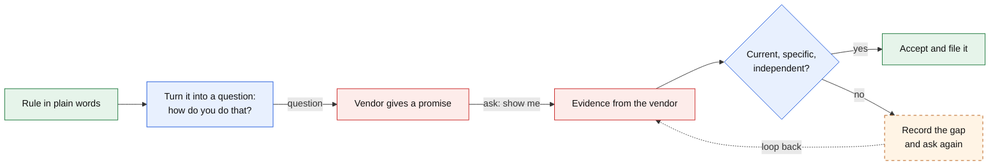
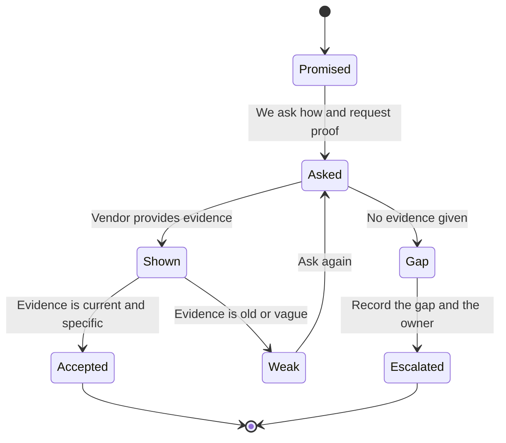

# Rules into Questions: Promise vs Proof

> **In one sentence:** Every rule becomes a plain question, "how do you do that, and show me", and your job is to tell a promise from proof.

## The everyday picture

> A restaurant says "our kitchen is spotless". That is a promise. The hygiene certificate on the wall is proof. You do not argue with the restaurant. You ask to see the certificate, and you check the date.

## How it works

1. **Start with the rule in plain words.** For example: "Customers must be told when AI is involved."
2. **Turn it into a question.** "How do you make sure customers are told?"
3. **Add "show me".** "Show me where and when they are told."
4. **Check the proof.** Four quick checks: is it current, does it cover our use, who produced it, and can we repeat it?
5. **Decide and record.** Accept it, ask again, or record a gap with an owner.

> **Key warning:** Words like "secure", "compliant", "best practice" and "industry standard" are promises. They only become proof when a document, a log or a test result sits behind them.

## See it

Read it left to right: a rule becomes a question, and a promise only passes when the evidence is current, specific and independent.

### The life of one vendor statement

Read it from the top: every statement in a proposal should end as accepted or escalated, never left as "promised".

## Rules turned into questions

These are examples of the kind of requirement a team may hold. What your own rules actually require is a matter for your legal team. This table only shows how to turn a requirement into something you can check.

| Requirement in plain words | The question | The proof |
| --- | --- | --- |
| Customers must be told when AI is involved | How are customers told, and where? | Screenshot of the notice, the process, a sample letter |
| Personal data must stay in approved places | In which countries is our data stored and processed? | Data flow diagram, hosting clause in the contract |
| A person must be able to review and change an AI-assisted decision | Where does a person step in, and can they override? | Approval settings, a sample audit trail |
| Decisions must be recorded and explainable | What is recorded for each output, and for how long? | Sample logs, retention setting |
| The tool must not treat groups of people unfairly | How do you test this, and how often? | Fairness test results across groups |
| We must be able to leave the vendor and take our data | What happens to our data and the service if we leave? | Exit clause, deletion confirmation |

For the five big requirements, data protection, fairness, transparency, explainability and human oversight, see the companion page [requirements-to-controls.md](requirements-to-controls.md). It shows the controls to look for and the documents to request.

### How strong is the proof?

| Strength | Example | How far to trust it |
| --- | --- | --- |
| Weakest | A slide, a sales claim, "trust us" | Treat as a promise |
| Weak | A written policy or contract clause | It says what should happen, not what does |
| Stronger | Settings screenshots or logs from our own set-up | Shows what is switched on today |
| Strong | Test results on our own examples | Shows how it behaves on our work |
| Strongest | An independent audit, or a test we run ourselves | Not marked by the vendor |

## In an insurance setting

> Fictional - for training only. You are reading the vendor proposal for **ClaimAssist v1**, a chat tool for claims handlers. The vendor is Nimbus AI Solutions Ltd.

| Statement in the proposal | Promise or proof? | Your question | Proof to request |
| --- | --- | --- | --- |
| "Your data is secure and compliant." | Promise. No detail, no evidence. | Secure against what? Compliant with which requirements? | Independent security report, data flow diagram |
| "Vendor chat logs are kept for 30 days." | A fact, but it is missing the place. | In which country are the logs stored? Who can read them? | Hosting details, a retention setting screenshot |
| "The model is accurate." | Promise. No number, no test. | Accurate on which tasks, and tested how? | Test results on claims questions |
| "Handlers stay in control." | Promise. Control is not described. | Where exactly does the handler check or approve? | Screens or settings showing review steps |
| "We follow industry best practice." | Promise. "Best practice" is not a document. | Which standard, and who confirmed it? | Certificate or audit report, with date and scope |

Most of this table is promises. That is normal in a first proposal. Your job is to turn each one into proof or a recorded gap.

## What could go wrong

Reviewers make the same five mistakes. Each links to a step in the flow, because proof always describes one part of the journey.

| Mistake | What it looks like | Flow step it often concerns |
| --- | --- | --- |
| Accepting a promise as proof | "They said it is compliant, so tick." | Any |
| Proof that does not fit | A certificate for a different product, region or year | 4 and 7 |
| Proof about the vendor, not our use | Accuracy tested on general text, not claims questions | 5 |
| Asking once, never again | The model is updated and the old proof is no longer true | 4 and 5 |
| A gap with no owner | "We noted it" but nobody follows up | Any |

Four quick checks on any proof: **current** (what date?), **specific** (our use, our product?), **independent** (who made it?), **repeatable** (can we test it ourselves?).

## Two views

| Legal & Compliance asks | Risk Management asks |
| --- | --- |
| Is the promise written into the contract, or only in a slide? | How strong is this proof on the ladder above? |
| Were customers or staff told, and can we show it? | If the promise fails, how likely and how bad? |
| Who is accountable if the promise turns out false? | What control sits behind the promise, and how is it tested? |
| Does the notice or contract match what the tool really does? | What risk is left if we accept this evidence? |

## Questions to ask the vendor

1. For each promise in your proposal, where is the evidence?
2. Which statements are in the contract, and which are only in marketing material?
3. When was each piece of evidence produced, and for which version of the product?
4. Who produced it: you, or an independent party?
5. Can we run the test ourselves on our own examples?
6. How will you tell us when something changes?

## Proof to ask for

| Proof item | What it shows | Red flag if missing |
| --- | --- | --- |
| Contract clauses matching each promise | The promise is binding | Promises appear only in marketing material |
| Dated test results on our own examples | How it behaves on our work | Only general or old results |
| Independent audit or certificate with scope and date | A third party checked the claim | Self-written statements only |
| Screenshots or logs from our own set-up | What is switched on today | "It is the default" with nothing shown |
| Change notice process | We will be told when things change | Updates arrive silently |

## Key takeaways

- A promise says what should happen. Proof shows what does happen. Ask for the certificate.
- Turn every rule into "how do you do that, and show me", then check that the proof is current, specific and independent.
- Never leave a promise open. End each one as accepted, or as a gap with an owner.
