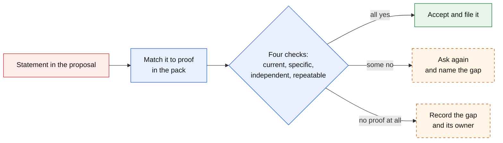

# Hands-on: Promise or Proof?

> **In one sentence:** You read a vendor's eight statements and the proof pack attached to them, then decide which statements are backed by proof and which are only promises.

**Time:** 20 minutes. **Group size:** 4 to 5 people, a mix of Legal & Compliance and Risk Management. No AI tool is needed for this exercise.

## Your task

Nimbus AI Solutions Ltd has sent its proposal for **ClaimAssist v2**. It contains eight statements, and the vendor attached a proof pack.

Today's date for this exercise is 25 November 2026. You are the review team. Decide how far each statement is backed by the proof, and what you would ask for before saying yes.

> **Key warning:** The vendor and every document here are fictional. Never type real company or customer information into any AI tool.

## Material

### How to review one statement

Read it left to right: each statement is matched to proof and put through four checks, and it ends as accepted or as a named gap.

### The two documents

| File | What it is |
| --- | --- |
| [claimassist-v2-proposal-extract.md](documents/claimassist-v2-proposal-extract.md) | The vendor's eight statements, S1 to S8 |
| [vendor-proof-pack.md](documents/vendor-proof-pack.md) | Six attachments, A to F |

The four checks:

- **Current.** What date is it from, and does it cover today's product version?
- **Specific.** Does it cover our use and our product?
- **Independent.** Who produced it?
- **Repeatable.** Can we run the test ourselves?

## Steps

### Part A: Match statements to proof (10 minutes)

1. Read the eight statements and the six attachments.
2. On Sheet 1, mark each statement as a **promise** or a **fact**, and write which attachment backs it, if any.
3. Name the first of the four checks that fails. Then give a verdict: accept, ask again, or gap.

### Part B: Write the requests and decide (5 minutes)

4. Choose the two gaps that worry your group most. Fill in Sheet 2.
5. Fill in Sheet 3. Decide: accept, accept with conditions, or do not proceed yet.

## Your answer sheet

### Sheet 1: Statement by statement

| Ref | Promise or fact? | Proof offered (A to F, or none) | Which check fails? (current, specific, independent, repeatable) | Verdict |
| --- | --- | --- | --- | --- |
| S1 | | | | |
| S2 | | | | |
| S3 | | | | |
| S4 | | | | |
| S5 | | | | |
| S6 | | | | |
| S7 | | | | |
| S8 | | | | |

### Sheet 2: The two gaps that worry you most

| Ref | Question to the vendor | Proof to request | Owner |
| --- | --- | --- | --- |
| | | | |
| | | | |

### Sheet 3: Your group's decision

| Question | Your answer |
| --- | --- |
| Accept, accept with conditions, or not yet? Why? | |
| Legal & Compliance: which statement must be in the contract, not only in the proposal? | |
| Risk: which statement is the most dangerous to accept on trust, and what is left if it fails? | |

## Questions to ask the vendor

1. For each statement in your proposal, where is the evidence?
2. Which statements are in the contract, and which are only in marketing material?
3. When was each piece of evidence produced, and for which version of the product?
4. Who produced it: you, or an independent party?
5. Can we run the test ourselves on our own examples?
6. How will you tell us when something changes?

## Proof to ask for

| Proof item | What it shows | Red flag if missing |
| --- | --- | --- |
| Contract clauses matching each statement | The promise is binding | Promises sit only in marketing material |
| Dated test results on our own examples | How it behaves on our work | Only general or old results |
| Independent audit with scope and date | A third party checked the claim | Self-written statements only |
| Screenshots or logs from our own set-up | What is switched on today | "It is the default" with nothing shown |
| Change notice process | We hear about changes | Updates arrive silently |

## Key takeaways

- A promise is not proof. Match every statement to evidence, then check it is current, specific, independent and repeatable.
- Proof can be real and still not fit: old, for another product, or for a different scope.
- End every statement as accepted, or as a gap with an owner.
