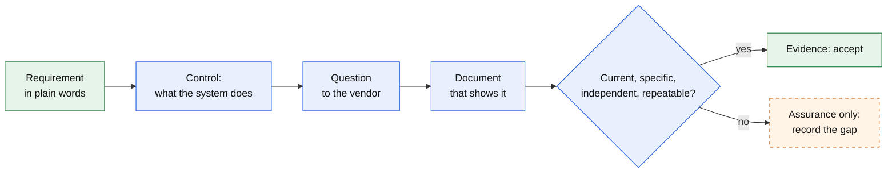

# Hands-on: Translate It

> **In one sentence:** You read a vendor's answers on five broad requirements for an agent, and judge each one as assurance or evidence.

**Time:** 15 minutes. **Group size:** 4 to 5 people, a mix of Legal & Compliance and Risk Management. No AI tool is needed for this exercise.

## Your task

Nimbus AI Solutions Ltd proposes **ClaimAssist v3**, an agent that drafts and sends settlement letters. The proposal says it meets your requirements on data protection, fairness, transparency, explainability and human oversight.

Use the table "Questions and documents for each" in [requirements-to-controls.md](requirements-to-controls.md) as your checklist. Read the vendor's answers and decide how far each is backed by evidence. Today's date for this exercise is 25 November 2026.

> **Key warning:** The vendor and every document here are fictional. This exercise does not say what any law requires. It practises turning a requirement into something you can check.

## Material

### The ladder you will climb

Read it left to right: each requirement becomes a control, a question and a document, and the document either earns acceptance or is recorded as a gap.

### The vendor's answers

Read the vendor's five answers and attachments here: [vendor-response-pack.md](documents/vendor-response-pack.md).

### What ClaimAssist v3 does

> Fictional - for training only.

- It reads claim files and drafts settlement letters.
- It sends letters to customers by email and updates the claims system.
- It uses a third-party model reached over the internet through the vendor.

## Steps

1. **Judge the answers (9 minutes).** Read the vendor's pack. For each requirement, fill in a row on Sheet 1: is it **assurance** (a statement) or **evidence** (a document that shows it)? What is missing or weak? What is your verdict: accept, ask again, or gap?
2. **Decide (3 minutes).** Fill in Sheet 2.

## Your answer sheet

### Sheet 1: The vendor's answers

| Requirement | Assurance or evidence? | What is missing or weak? | Verdict |
| --- | --- | --- | --- |
| R1. Data protection | | | |
| R2. Fairness | | | |
| R3. Transparency | | | |
| R4. Explainability | | | |
| R5. Human oversight | | | |

### Sheet 2: Your group's decision

| Question | Your answer |
| --- | --- |
| Which control looked real on paper but not in the numbers? | |
| Legal & Compliance: who is accountable for a letter a handler clicked through without reading? | |
| Risk: how likely is a wrong letter to pass, and what is left if the review is a rubber stamp? | |

## Questions to ask the vendor

1. For each requirement, which controls in your system make it true?
2. Which of those controls are switched on in our set-up today?
3. Which documents show each control?
4. When was each produced, and for which product version?
5. Can we repeat the test ourselves?

## Proof to ask for

| Proof item | What it shows | Red flag if missing |
| --- | --- | --- |
| Data flow diagram with regions and suppliers | Where data goes | "It is in the cloud" |
| Fairness test report by group, dated | Similar cases get similar outcomes | One overall score |
| Notices and sample letters as customers see them | People are told | A banner in a test screen only |
| Sample log with model version and sources | A case can be rebuilt | Logs without version or sources |
| Approval settings with review statistics | A human check exists and is real | Approval off by default, or never refused |

## Key takeaways

- Turn each requirement into a control, a question and a document.
- Real evidence is current, specific, independent and repeatable. Assurance is a statement.
- Read the numbers. A control that exists can still be hollow.
