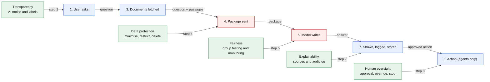
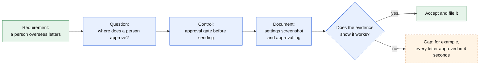

# From Requirement to Control

> **In one sentence:** A broad requirement such as fairness becomes checkable when you ask which control in the system makes it true, and which document proves that control exists.

This page does not say what any law or rule requires. That is for your own legal teams. It shows how to turn a requirement you already hold into questions and evidence requests.

## The everyday picture

> A building must be "fire safe". That is a broad requirement. You cannot inspect it directly. You inspect the sprinklers, the fire doors, the alarm and the exit signs. Then you ask for the inspection certificate. The requirement is the goal, the controls are the parts, and the certificate is the proof.

## How it works

1. **Name the requirement in plain words.** For example: "A person must be able to oversee the tool."
2. **Ask what the system does to make it true.** These are the controls: approval steps, access limits, logs, tests.
3. **Ask what you would see if the control were real.** A setting, a log entry, a test result, a screen.
4. **Request the document that shows it.** Then check it: current, specific, independent, repeatable.

> **Key warning:** A requirement with no control behind it is a wish. A control with no document behind it is a promise.

## See it

Read it left to right: the blue and red boxes are the flow, and each green box is a control that belongs at one step. Most requirements need controls at more than one step.

### One requirement, all the way down

Read it left to right: the evidence decides the outcome, not the existence of the control.

## The five requirements, translated

| Requirement | What it means in plain words | Controls to look for in the system | Flow step |
| --- | --- | --- | --- |
| Data protection | Personal data goes only where it should, for as long as it should | Send only the data the task needs. Access limits and permission checks. Encryption. Retention limits and deletion. A switch that stops use for training. Controls on suppliers. | 3, 4, 7 |
| Fairness | Similar people get similar outcomes | Testing across groups before release. Monitoring results by group. Limits on inputs that stand in for sensitive traits. Human review of adverse outcomes. | 5 and training data |
| Transparency | People know AI is involved and what it can and cannot do | A notice to staff and customers. Labels on AI-written content. A plain description of the tool and its limits. | 1 and 7 |
| Explainability | You can show what went in, what came out, and why | Sources shown with answers. Logs of input, output and model version. Reason codes for scores. The ability to reproduce a result. | 5 to 7 |
| Human oversight | A person can check, correct and stop the tool | An approval step before actions. Override and escalation. Warning when the tool is unsure. A stop switch. Limits on what the tool can do. Trained reviewers. | 6 and 8 |

### Questions and documents for each

| Requirement | Questions to ask | Technical documents to request |
| --- | --- | --- |
| Data protection | What data goes where, for how long, and who can read it? Is any of it used for training? How is deletion proved? | Data flow diagram. Retention and deletion settings. Access control matrix. List of suppliers. Contract terms on data use. Independent security report. A privacy or data protection impact assessment, if one was done. |
| Fairness | Which groups did you test? What gaps did you find? How do you monitor after release, and who acts on a gap? | Fairness test report with groups, measures, results and date. A description of the data used to train and test. Sample monitoring report. Change log of fixes. |
| Transparency | How are staff and customers told? Where does the notice appear? What does it say about limits? | Screenshots of notices and labels. A sample customer letter. User guide with limits. Plain system description, often called a model or system card. |
| Explainability | For one real case, can you show the input, the version, the sources and the output? | A sample audit log entry. Sample answers showing sources. Method description for scores. A worked example case. |
| Human oversight | Where does a person step in? What does the tool do if the person says no? How often do reviewers override it? | Workflow diagram showing the human step. Approval and override settings. Stop procedure. Review statistics, such as override rate and review time. Reviewer training records. |

### Assurance or evidence?

| Vendor assurance | Weak evidence | Evidence that would convince you |
| --- | --- | --- |
| "We protect your data." | A privacy policy page | Data flow diagram with regions, retention settings from your own set-up, contract clause on training |
| "We test for bias." | An overall accuracy number | Results by group, with dates, measures and the gaps found |
| "Users are always informed." | A banner in the chat window | The notice on the screens and letters customers actually see |
| "Every answer can be traced." | A log with a time and a user | A log entry showing input, output, sources and model version, with a stated retention period |
| "Humans stay in control." | A statement that approval is available | Approval settings that are on, plus an approval log with override rates and review times |

## In an insurance setting

> Fictional - for training only. Nimbus AI Solutions Ltd proposes **ClaimAssist v3**, an agent that drafts and sends settlement letters. The proposal says: "Handlers stay in control."

Walk down the ladder for human oversight:

- **Requirement.** A person oversees every settlement letter.
- **Question.** Where does the handler approve a letter before it goes?
- **Control.** An approval step that stops the letter until a person accepts it.
- **Document.** A screenshot of the setting, and a log of approvals.
- **Check.** The log shows 4,812 letters approved, 9 rejected, and a median review time of four seconds.

The control exists. The evidence shows a person clicking through, not reading. That is a finding, not a pass. Ask how long a handler needs to read a letter, and whether the approval is a real check.

## What could go wrong

| Mistake | What it looks like | Flow step |
| --- | --- | --- |
| The requirement is never translated | "We care about fairness" with no named control | Any |
| The control exists on paper only | A policy says approval is required, but the setting is off | 8 |
| The control is real but untested | A bias filter with no results | 5 |
| The control covers only one step | Encryption is shown, retention is not | 4 and 7 |
| The proof comes from the vendor's demo, not our set-up | A screenshot from a test system | Any |

## Two views

| Requirement | Legal & Compliance asks | Risk Management asks |
| --- | --- | --- |
| Data protection | Is there a contract and a basis for sending this data? | How likely and how bad is a leak? What controls reduce it? |
| Fairness | Could this treat groups of people differently? | How do we test for it, and what gap is acceptable? |
| Transparency | Were people told, in the right place and the right words? | What happens if they are not? |
| Explainability | Can we show a customer or reviewer why this happened? | How long do we keep the records, and could we rebuild a case? |
| Human oversight | Who is accountable for each decision? | Is the human check real, and what is left if it fails? |

## Questions to ask the vendor

1. For each of the five requirements, which controls in your system make it true?
2. Which of those controls are switched on in our set-up today?
3. Which documents show each control? Please list them by name.
4. When was each one produced, and for which version?
5. Who produced it, and can we repeat the test?
6. How will you tell us if a control changes?

## Proof to ask for

| Proof item | What it shows | Red flag if missing |
| --- | --- | --- |
| Data flow diagram with regions and suppliers | Where data goes and who handles it | "It is in the cloud" |
| Access control matrix | Who can see and do what | "It follows our permissions" with no table |
| Fairness test report by group, dated | Whether similar cases get similar outcomes | One overall score |
| Plain system or model description with limits | What the tool is for and what it cannot do | Marketing text only |
| Sample audit log entry with model version | A case can be traced and rebuilt | Logs without version or sources |
| Approval settings and review statistics | A human check exists and is real | Approval "available" but off, or never refused |
| Stop and escalation procedure | The tool can be halted and issues are raised | No stop, or it needs the vendor |
| Independent audit with scope and date | A third party checked the claim | Self-written statements only |

## Key takeaways

- Translate each requirement into three things: the control, the question and the document.
- Assurance says it is done. Evidence shows it is switched on, tested and current.
- A real control can still be hollow. Look at the numbers, such as override rates and review times.
