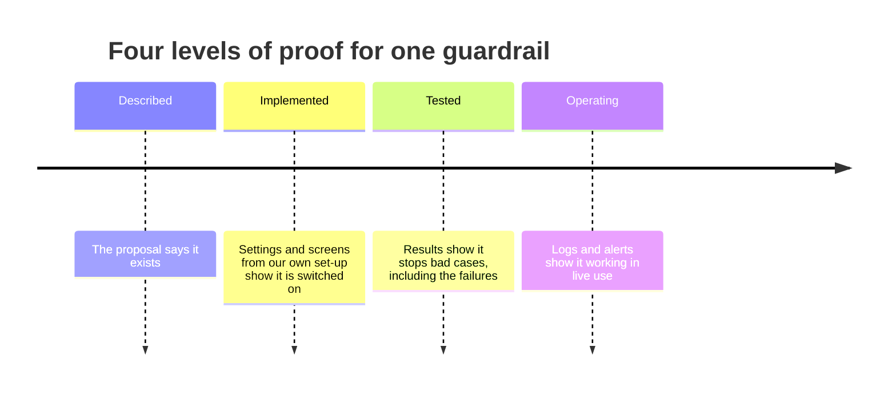

# Guardrails and Controls: Described, Implemented, Tested

> **In one sentence:** Guardrails are layers of safety around an AI tool, and a layer only counts when you have seen evidence that it is switched on, tested and working, not just described in a proposal.

## The everyday picture

> Airport security has layers: a passport check, a bag scan, a gate check, a supervisor, CCTV and an emergency stop. No single layer catches everything. Together they make it hard for something bad to get through. A sign saying "we scan every bag" is not a scan. You want to see the machine, the test and the log.

## How it works

1. **Use several layers, not one wall.** Each layer catches different problems.
2. **Place each layer at a step in the flow.** Some work before the model, some after.
3. **Expect every layer to miss something.** The layers overlap on purpose.
4. **Judge each layer by its evidence.** A layer has four levels of proof: described, implemented, tested and operating.

### The seven controls

| Airport layer | Control | Plain meaning | Flow step |
| --- | --- | --- | --- |
| Passport check | Access controls | Check who is asking and what they may see or do | 1 and 3 |
| Bag scan | Input filters | Check what goes into the tool, such as hidden lines or unsuitable requests | 2 to 4 |
| Bag scan | Data-loss prevention | Stop sensitive data leaving, for example an account number in a prompt | 4 and 7 |
| Gate check | Output filters | Check the answer before it is shown or used | 6 |
| Supervisor | Human approval checkpoints | A person approves risky outputs and actions | 6 to 8 |
| CCTV | Monitoring and audit trails | Watch live, and keep a record that can be replayed | 7 onward |
| Emergency stop | Escalation mechanisms | Raise the alarm, name an owner and halt the tool | Any |

## See it

```mermaid
flowchart LR
    U["Claims handler"]:::human -- "1. question" --> AC["Access control<br/>who may ask, what they may see"]:::inside
    AC -- "3. permitted files only" --> IF["Input filter and<br/>data-loss check"]:::inside
    IF -- "4. cleaned package" --> LLM["Vendor's AI model"]:::outside
    LLM -- "5. draft answer" --> OF["6. Output filter"]:::inside
    OF -- "answer or action request" --> HA["Human approval"]:::human
    HA -- "8. approved action" --> ACT["Action in claims system"]:::inside
    AC -. "events recorded" .-> LOG[("Monitoring and audit trail")]:::inside
    OF -. "events recorded" .-> LOG
    HA -. "events recorded" .-> LOG
    LOG -- "alerts" --> ESC["Escalation:<br/>owner and stop switch"]:::human
    R["Risk: a layer that exists<br/>only on paper"]:::risk -. "hole in the layers" .-> IF
    classDef inside fill:#E8F0FE,stroke:#1A56DB,color:#111;
    classDef outside fill:#FDECEA,stroke:#C81E1E,color:#111;
    classDef human fill:#E6F4EA,stroke:#137333,color:#111;
    classDef risk fill:#FFF4E5,stroke:#B45309,color:#111,stroke-dasharray: 5 5;
```

Read it left to right: each layer sits between the handler and the action, and the dashed lines show what is recorded for monitoring and alerts.

### What a guardrail needs before you can rely on it

Read it from left to right: each level is stronger than the one before, and a proposal alone only reaches the first.

## In an insurance setting

> Fictional - for training only. Nimbus AI Solutions Ltd proposes **ClaimAssist v3**, an agent that drafts and sends settlement letters. Its proposal lists guardrails. Each one reads well.

Take data-loss prevention. The proposal says: "Sensitive data is blocked from leaving." Walk up the four levels:

| Level | What you ask | What you might find |
| --- | --- | --- |
| Described | Does the proposal say it? | Yes, in one sentence |
| Implemented | Is it switched on in our set-up? | A rule list exists. It names card numbers and bank accounts. It does not name health details. |
| Tested | Did anyone try it? | A test of 20 messages. All 6 card numbers were blocked. None of the 8 health messages were. |
| Operating | Is it working in live use? | Zero blocks in 90 days. Either nothing was sent, or the rule is not firing. |

The sentence "sensitive data never leaves" is not true for health details. Nobody lied. The layer was described broadly and built narrowly.

## What could go wrong

| Problem | What it looks like | Flow step |
| --- | --- | --- |
| Described, not built | A layer in the proposal with no setting or screen | Any |
| Built, but off by default | Approval exists, but teams must switch it on | 8 |
| Covers part of the job | Approval for letters, none for status or payment changes | 8 |
| Tested only on easy cases | Tests on general content, not on our risks | 6 |
| Works in the demo, not in live use | A screenshot from a test system | Any |
| Nobody watches the alerts | A dashboard of counts, no alerts, no owner | 7 onward |
| Records too short | Logs deleted after seven days | 7 |
| Stop switch needs the vendor | Escalation takes a day | Any |
| Layer blocks too much | Staff work around it with unapproved tools | 4 |

## Two views

| Legal & Compliance asks | Risk Management asks |
| --- | --- |
| Is each guardrail a contract commitment or only a description? | Which layers cover which risks, and where are the gaps? |
| Does the audit trail keep what we may need, for long enough? | How would we know if a layer stopped working? |
| Who is accountable for each layer and for the stop decision? | What is left if one layer fails? |
| Were staff told what each layer does and does not do? | How strong is the evidence for each layer, and how old is it? |

## Questions to ask the vendor

1. Which guardrails exist? Please list each one and the step where it applies.
2. Which are switched on in our set-up today, and which are optional?
3. What does each one cover, and what does it not cover?
4. How was each tested? Show the cases that failed as well as those that passed.
5. What is recorded, for how long, and who watches the alerts?
6. Who can stop the tool, how fast, and without calling the vendor?

## Proof to ask for

| Proof item | What it shows | Red flag if missing |
| --- | --- | --- |
| Settings screenshots from our own set-up | Each layer is switched on | Screens from a demo system |
| Test results with cases that passed and failed | The layer works, and where it does not | Only passed cases, or no results |
| Test coverage list | What the tests did and did not cover | Tests on easy or general cases |
| Approval settings and review statistics | A human check exists and is real | Approval off by default, or never refused |
| Sample audit log entry and retention period | A case can be rebuilt | Logs with no version or very short retention |
| Monitoring dashboard with alert rules and owners | Someone watches and acts | Counts only, no alerts, no owner |
| Incident and stop procedure with names and times | The tool can be halted fast | A procedure with no owner, or a stop through the vendor |

## Key takeaways

- Guardrails are layers. Each layer catches different things, and each one can miss.
- A layer has four levels of proof: described, implemented, tested and operating. A proposal reaches only the first.
- Ask to see the failures. A test that shows no failures is a warning, not a comfort.
