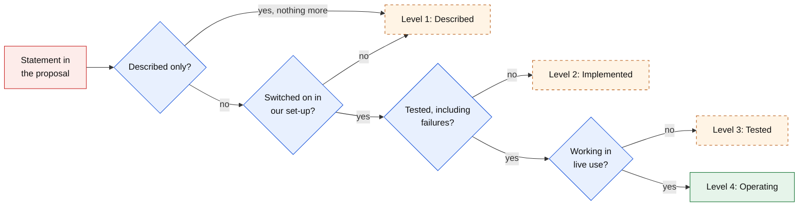

# Hands-on: Layers on Paper or in Practice?

> **In one sentence:** You take seven guardrails a vendor says it has, check each against the evidence it sent, and decide how far each one is proven.

**Time:** 30 minutes. **Group size:** 4 to 5 people, a mix of Legal & Compliance and Risk Management. No AI tool is needed for this exercise.

## Your task

Nimbus AI Solutions Ltd proposes **ClaimAssist v3**, an agent that drafts and sends settlement letters. Its proposal lists seven guardrails. You asked for evidence, and the vendor sent a folder.

You are the review team. For each guardrail, decide how far it is proven: **described**, **implemented**, **tested** or **operating**. Find the hole in each one. Today's date for this exercise is 25 November 2026.

> **Key warning:** The vendor and every document here are fictional. Do not present any statement as real.

## Material

### How to check one guardrail

Read it from the left: a guardrail climbs one level at a time, and it stops at the first question you cannot answer yes to.

### The two documents

| File | What it is |
| --- | --- |
| [claimassist-v3-guardrails-proposal.md](documents/claimassist-v3-guardrails-proposal.md) | The seven statements, G1 to G7 |
| [guardrails-evidence-folder.md](documents/guardrails-evidence-folder.md) | What the vendor sent as evidence for each one |

### The four levels

| Level | What it means | Example evidence |
| --- | --- | --- |
| 1. Described | The proposal says it exists | A sentence in a proposal |
| 2. Implemented | It is switched on in our own set-up | Settings screenshot from our system |
| 3. Tested | Someone tried to make it fail and recorded the result, including failures | Test results with passes and fails |
| 4. Operating | It works in live use and someone watches it | Logs, alerts, review statistics |

## Steps

### Part A: Score each guardrail (15 minutes)

1. Read the seven statements, then the evidence folder. Split the seven between pairs to save time.
2. For each guardrail, decide the highest level the evidence proves. Use the decision diagram above.
3. Name the hole: what the statement claims that the evidence does not show.

### Part B: Write the requests (7 minutes)

4. Pick the two guardrails that worry your group most. Fill in Sheet 2.

### Part C: Make the call (4 minutes)

5. Fill in Sheet 3.

## Your answer sheet

### Sheet 1: Guardrail scorecard

| Ref | Layer | Highest level proven (1 to 4) | The hole |
| --- | --- | --- | --- |
| G1 | Access controls | | |
| G2 | Input filters | | |
| G3 | Data-loss prevention | | |
| G4 | Output filters | | |
| G5 | Human approval | | |
| G6 | Monitoring and audit trail | | |
| G7 | Escalation | | |

### Sheet 2: The two gaps that worry you most

| Ref | Question to the vendor | Evidence or test to request | Owner |
| --- | --- | --- | --- |
| | | | |
| | | | |

### Sheet 3: Your group's decision

| Question | Your answer |
| --- | --- |
| Accept, accept with conditions, or not yet? Which guardrail would you fix first? | |
| Legal & Compliance: which statement is the most misleading as written, and should it be in the contract? | |
| Risk: if one layer fails, which other layer would catch the problem? What is left? | |

## Questions to ask the vendor

1. Which guardrails are switched on in our set-up today, and which are optional?
2. What does each one cover, and what does it not cover?
3. How was each tested? Show the failed cases as well as the passed ones.
4. What is recorded, for how long, and who watches the alerts?
5. Who can stop the tool, how fast, and without calling the vendor?

## Proof to ask for

| Proof item | What it shows | Red flag if missing |
| --- | --- | --- |
| Settings screenshots from our own set-up | Each layer is on | Screens from a demo system |
| Test results with passes and failures | The layer works, and where it does not | Only passes, or no results |
| Approval settings and review statistics | A human check exists and is real | Approval off by default |
| Sample log with version, sources and retention | A case can be rebuilt | Logs without version, or very short retention |
| Alert rules with named owners | Someone watches and acts | Counts only |

## Key takeaways

- A guardrail has four levels of proof. A proposal reaches the first. Look for the others.
- Evidence can be real and still not fit the statement. Read what it actually covers.
- Ask to see the failures. A layer with no failed tests has probably not been tested.
